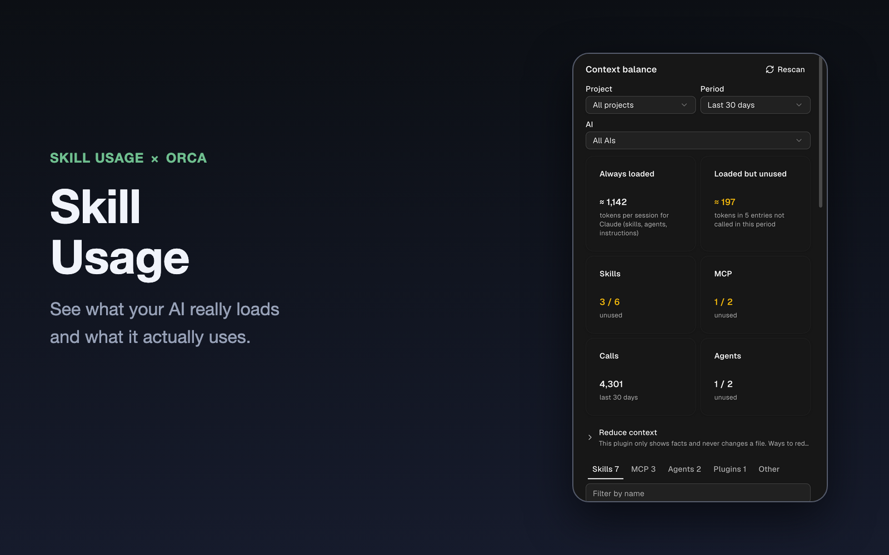
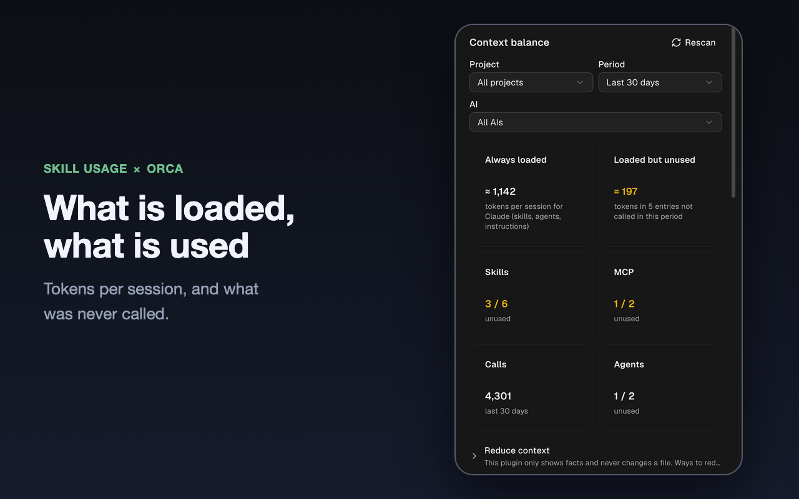
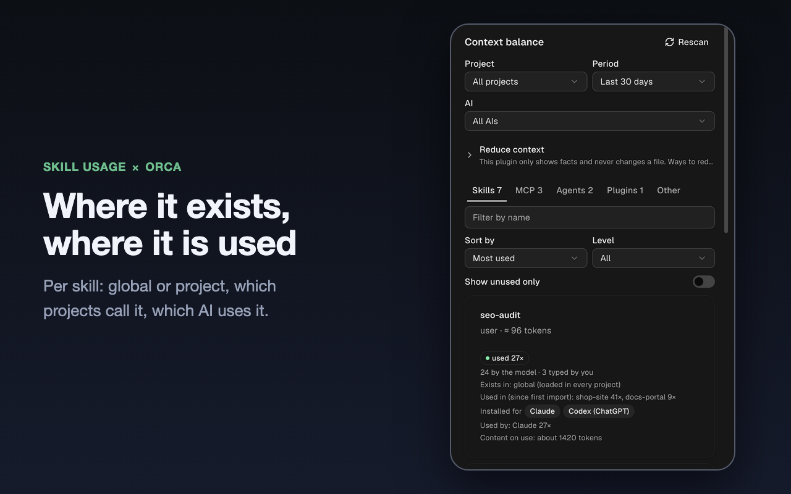
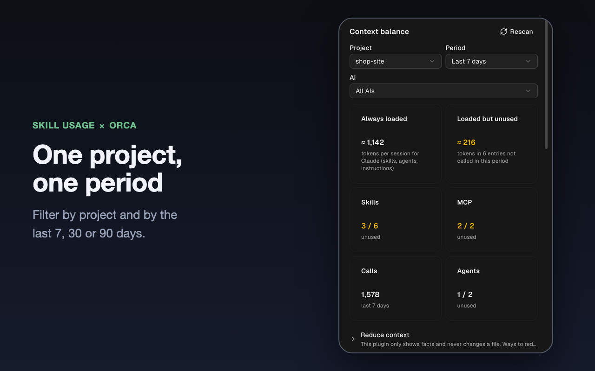
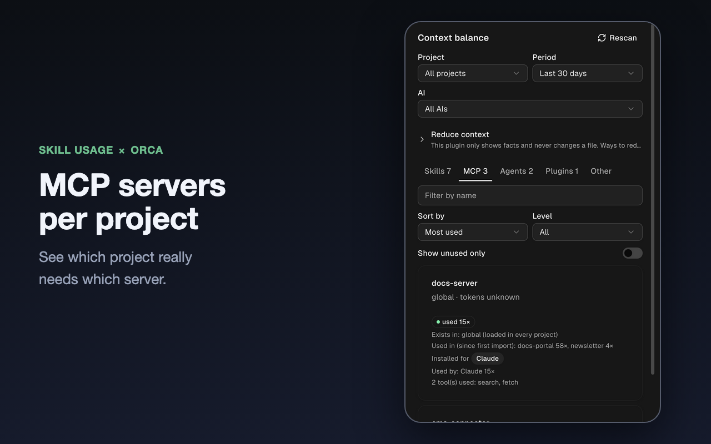
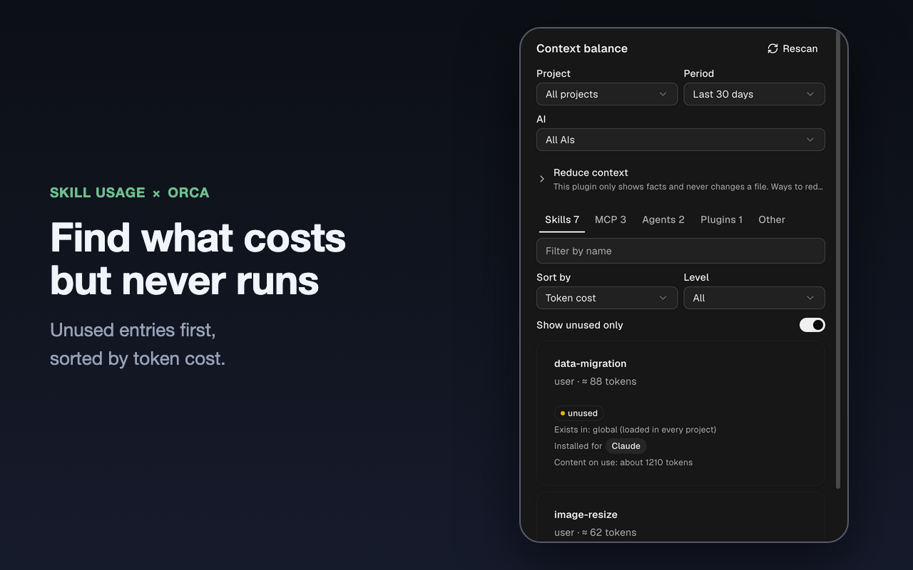
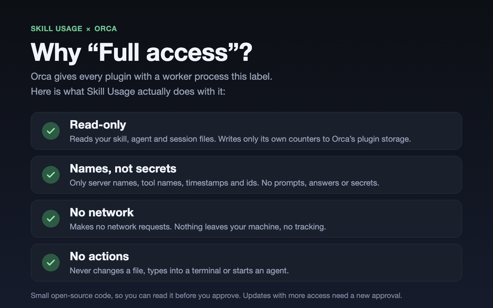

# Skill Usage for Orca: see which skills, MCP servers and agents you really use

An [Orca](https://github.com/stablyai/orca) plugin that shows which skills, MCP servers, agents and plugins of **Claude Code, Codex and Gemini** you actually use, and what the unused ones cost you in **context tokens**, per project.



## Why

Every installed skill, MCP server and agent adds its description to the context of **every** session. Most are used rarely, or in one project only, but they cost tokens every single time. Skill Usage reads your past sessions and shows you the facts, so you can decide what to keep.

## What you get

- **Token cost at a glance:** what is loaded in every session, and how much of it was never called.
- **Where it exists, where it is used:** global or project, which projects call it, which AI uses it.
- **Any project, any period:** latest session, 7, 30 or 90 days.
- **Numbers from day one:** it reads your existing session files, no waiting for data to build up.
- **Facts only:** it never changes a file and never tells you what to delete.
- English and German.

## See it

**What is loaded, what is used.** Tokens per session and the entries nobody calls.



**Where it exists, where it is used.** One card per skill, with its projects and AIs.



**One project, one period.** Find what a single project really needs.



**MCP servers per project.** See which project needs which server.



**Find what costs but never runs.** Unused entries, sorted by token cost.



## Install

Requires Orca 1.4.248 or newer.

1. In Orca, open **Settings → Plugins**.
2. Add the marketplace `https://github.com/stablyai/orca-community-plugins.git` (ref `main`).
3. Search for **Skill Usage**, install it and approve the access.

From source: `git clone https://github.com/brodesigns/orca-skill-usage`, then `orca plugin dev load .` in the folder.

## Privacy and access

Orca labels every plugin with a worker "Full access". Here is what this one does with it:



- Reads your skill, agent and session files. It writes only its own counters to Orca's plugin storage.
- From sessions it keeps only tool names, command names, timestamps, ids and project names. No prompts, no answers, no file contents. From MCP configs only server names, never env values or tokens.
- No network requests. It types into no terminal and starts no agent.
- It reads the workspace list only to find the folder of the focused workspace.

## Good to know

- Tokens are estimates (4 characters per token). The size of an MCP server's tool list is unknown, so MCP entries show usage only.
- Claude Code is read completely. For Codex only skill reads count, for Gemini there is no usage data: such entries show "no usage data" instead of "unused".
- "Unused" only means something with enough data for the chosen period.
- Slash commands you type count as usage, built-in ones such as `/model` do not.

<details>
<summary>How it works, develop</summary>

- **History:** past sessions are read once (Claude Code `~/.claude/projects` including subagents, Codex `~/.codex/sessions`), then only new lines. Counters are kept per day for 100 days.
- **Inventory:** skills and agents in `~/.claude`, `~/.codex` and `~/.agents`, enabled plugins, MCP server names (`~/.claude.json`, `~/.codex/config.toml`, `~/.gemini/settings.json`), `CLAUDE.md`, `AGENTS.md`, `GEMINI.md`, and the `.claude/skills`, `CLAUDE.md` and `.mcp.json` of each project.
- **Live:** an `agent.tool.after` hook counts tool calls of other AIs; Claude Code is counted from its session files.
- **Storage:** about 1 MB, stored in chunks because Orca limits a single value to 256 KiB.

```bash
orca plugin types .
orca plugin validate .
orca plugin test .
orca plugin dev watch .
```

Code in `src/`: `worker.ts` (hook, storage, import), `history.ts` (session import), `inventory.ts` (disk scan), `merge.ts` (inventory and usage), `usage.ts`, `store.ts`, `panel.tsx` (UI), `i18n.ts` (English and German), `protocol.ts`, `demo.ts` (made-up numbers for screenshots: set the storage key `demo` to `true`).

</details>

## About

Built and maintained by [BroDesigns](https://brodesigns.de), a web agency.

MIT license.
